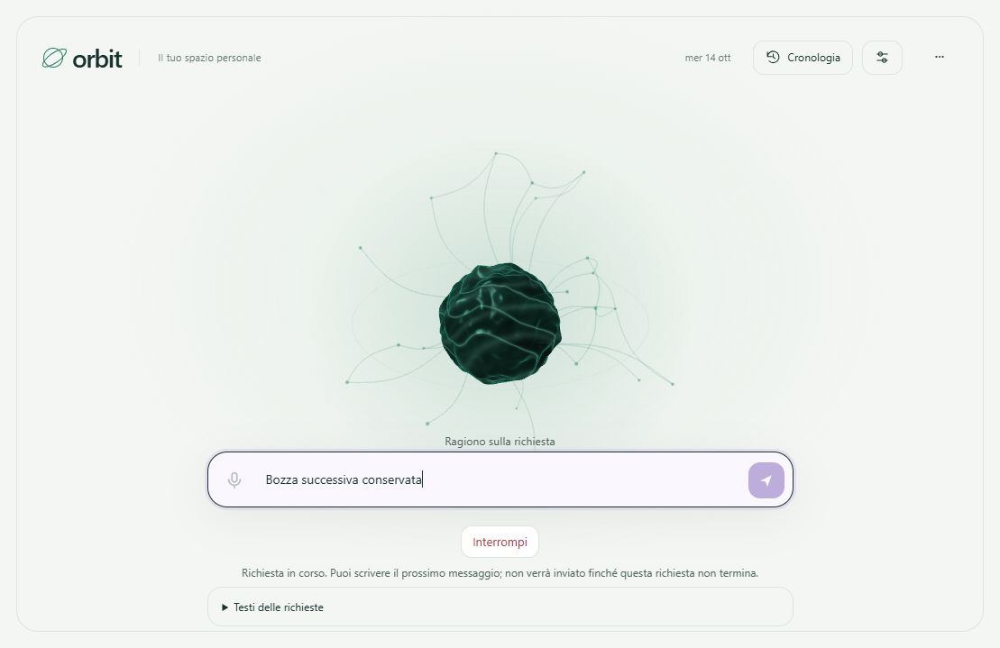
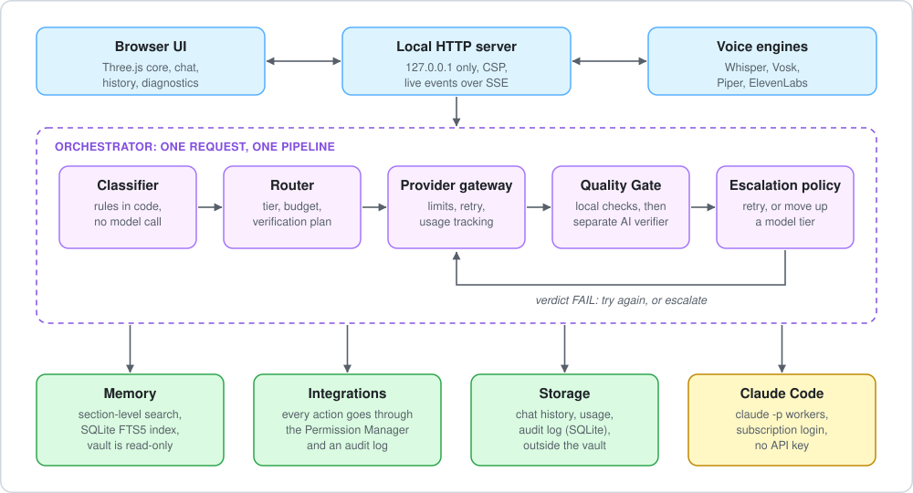
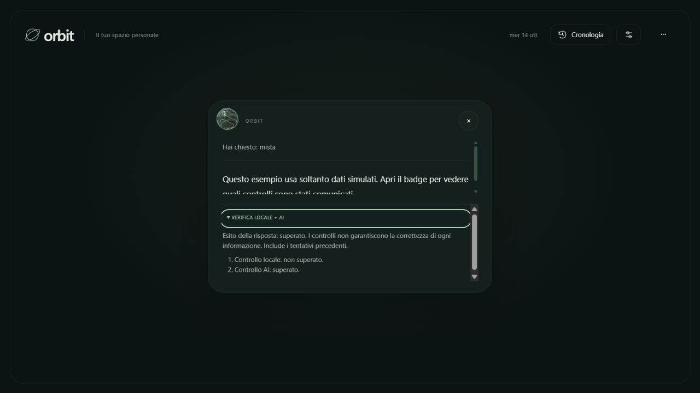

<div align="center">

# Orbit

**A local AI assistant for Windows that answers from your own Obsidian notes, picks the cheapest Claude model able to handle each request, and verifies every answer before showing it. Built with Node.js (no npm dependencies), SQLite and Three.js on top of Claude Code.**


[](LICENSE)



<sub>The web interface (light theme) while a request is running.</sub>

</div>

## What it is

Orbit runs on your PC and opens in your browser at `localhost:4778`. You type or dictate a question, and it answers using your Obsidian vault, folders you authorize, web search, and read-only Google Calendar and Gmail, reading the answer aloud if you want. The interface and the routing heuristics are in Italian, because that is the language it was built to be used in.

What sets it apart is that it treats a Claude subscription as a budget instead of an unlimited resource. A rule-based router picks Haiku, Sonnet or Opus for each request without spending a model call to decide. A separate verifier checks the answer against explicit criteria and the cited notes before it is shown. The assistant moves up a model tier only when that verification fails. Anything it can change in your vault goes through a confirmation, a backup and an audit log.

## Highlights

**Cost-aware routing.** A deterministic classifier and router choose the model tier in code, so deciding costs nothing. Escalation is bounded by per-request token budgets plus hourly and daily call limits, which keeps a subscription usable.

**Answers are verified before display.** Local checks run first (empty or truncated output, language, cited note paths, arithmetic recomputed locally, JavaScript and JSON syntax). For riskier requests and answers based on your notes, a separate verifier model returns PASS, FAIL or NEEDS_CLARIFICATION with evidence.

**Memory that never writes to your vault.** Retrieval works on note sections through a rebuildable SQLite FTS5 index stored outside the vault, so Obsidian Sync never sees it, and answers carry the paths of the notes they used.

**Gated writes.** Every action has a declared risk level. Modifying or irreversible actions always need a one-time confirmation tied to the exact operation, and every vault write is backed up first.

**No API key.** Orbit drives the unmodified `claude` CLI with your subscription login, removes API and cloud-provider variables from the child process, and refuses to chat on a metered login.

**Voice that degrades gracefully.** Dictation runs locally with Whisper, the wake word «Orbit» with Vosk, and speech with ElevenLabs, falling back automatically to a local Piper voice when the key, the credits or the network are missing.

## Download and first run

There is no installer or packaged release yet. Orbit is a Node.js application that you run from source.

| Platform | What to get | Status |
| :-- | :-- | :-- |
| Windows 11 | [Source ZIP](../../archive/refs/heads/main.zip) or `git clone`, then double-click `avvia-orbit.bat` | Supported and the only tested platform |
| macOS, Linux | Source only | Not supported: Google tokens are encrypted with Windows DPAPI and the voice installers download Windows binaries. The memory module, its benchmark and part of the tests run |

Before the first start you need Node.js 22.5 or newer, Claude Code signed in with a claude.ai subscription (`claude auth status` must report `claude.ai`), and an Obsidian vault, which can be empty but must contain a `.obsidian` folder. On first start Orbit opens your browser at `http://localhost:4778`. Open Settings (the gear icon) to see whether the subscription, the models and the memory are healthy. If Orbit does not find your vault, set `ORBIT_VAULT_PATH` as described under [Usage](#usage). Voice models are optional and downloaded once with the installers in [Building from source](#building-from-source).

## Architecture

<picture>
  <source media="(prefers-color-scheme: dark)" srcset="docs/architecture-dark.svg">
  
</picture>

The code is split along one rule: each layer knows only the contract of the layer below it. `orbit/app.js` is the composition root and takes every dependency as an injectable parameter, which is how the tests replace the model provider, storage and voice engines with fakes.

- **Request pipeline (`orbit/orchestrator.js`, `orbit/ai/`).** One request flows through the classifier, the router, the provider gateway, the quality gate and the escalation policy. The router and the policy are pure functions that never call a model. Every model call, including the verifier's, passes through the gateway, which applies budgets, timeouts, retries and usage tracking. The orchestrator emits an event at each step, and the animated core in the UI is driven only by those events, so it never shows work that is not happening.
- **Model provider (`orbit/ai/providers/`).** A small contract (`executeTask`, `discoverCapabilities`, `listAvailableModels`, `cancelExecution`, `healthCheck`) with a Claude Code implementation. Nothing above it knows whether a call ran in a fresh process or a warm one.
- **Memory (`memoria/`).** A separate read-only module with its own CLI and an MCP server. It can run without the rest of Orbit, and a static check flags file-write calls in it outside the index code.
- **Integrations (`orbit/integrations/`).** Documents, web, Google, Obsidian writes and Smart Inbox all register with one manager that applies permissions and the audit log. Permissions and the audit log are applied there, so a new integration inherits them.
- **Smart Inbox (`smart-inbox/`).** Deliberately outside `orbit/` with its own static checks, because it can write notes and has its own threat model (see the engineering notes).
- **UI (`orbit/public/`).** Plain JavaScript with no build step and a strict Content Security Policy, so the page contains no inline script or style.

## Engineering notes

### 1. Using a subscription CLI as a model backend without touching metered billing

**Problem.** Claude Code is the only model backend, and an exported `ANTHROPIC_API_KEY` or a cloud-provider variable would silently switch it to pay-per-use billing.

**Solution.** The adapter starts the unmodified `claude` binary with structured arguments and no shell, passes the prompt on stdin, and turns tools off, stores no session and uses a neutral working directory outside the vault. It strips `ANTHROPIC_*`, `CLAUDE_CODE_USE_*` and similar variables from the child environment, and checks `claude auth status` for a claude.ai login before doing any work. A static check also fails the build if the codebase references the metered API.

**Trade-off.** Orbit depends on a CLI whose limits it cannot see in advance: usage limits surface only as errors when they are reached. Automating a consumer subscription may also conflict with the provider's terms (see [Responsible use](#responsible-use)).

### 2. Taking process start-up out of the latency path

**Problem.** Starting `claude -p` for every call added roughly 3 seconds of start-up before the model even began.

**Solution.** The persistent mode keeps a small pool of `claude` processes already running in `stream-json` mode, one pool per model. A process serves exactly one turn and is then replaced, so no content can leak from one request to another. The answer is taken at the first `message_stop` event instead of waiting for the summary event that arrives about 2 seconds later. Only process-level faults (crash, invalid protocol, no free worker) trigger a single retry through the classic path; timeouts, cancellations and subscription limits are never retried. After three consecutive faults a circuit breaker disables the pool for five minutes. Measured on three consecutive requests with the real pipeline, average latency went from 5.2 s to 1.8 s (details and the raw numbers in [docs/PERFORMANCE.md](docs/PERFORMANCE.md)).

**Trade-off.** Each warm process holds about 190 MB of RAM, the sample is small (one account, three requests), and web search stays on the classic path after the persistent mode returned an invalid-protocol error on multi-message turns. That problem is still open.

### 3. Verification that does not double the cost

**Problem.** Checking every answer with a second model doubles the spend, and a verifier that errors out must never count as a pass.

**Solution.** Classification and routing are plain code. The verification plan depends on the request: light conversation and arithmetic are checked locally only, and the AI verifier runs only when complexity is high, risk is not low, or the answer is based on your notes (`ORBIT_AI_VERIFY=auto`). The verifier receives the excerpts of the sources that share terms or numbers with the answer instead of the whole context, except when the answer claims something is absent, which needs the full sources. A verifier error returns `ERROR` and gets one re-verification before the answer is delivered marked as unverified. The escalation policy has ceilings on attempts, escalations and tokens, so it cannot loop, and a request recognized as high risk, such as a medical or financial question, can never run on the lightest model.

**Trade-off.** The classifier and the risk rules are hand-tuned Italian patterns. They are cheap, deterministic and covered by positive and negative test cases, but they only recognize what someone anticipated. The verifier is also a model, and its confidence score is self-reported.

<p align="center">
  
  <br>
  <sub>The verification badge on an answer, rendered with simulated data.</sub>
</p>

### 4. A memory layer that cannot damage the vault

**Problem.** The vault is the user's most valuable data. Retrieval must never modify it, must survive a corrupted index, and must not leak into a sync service.

**Solution.** The full-text index is contentless: it stores only the indexed terms, and the text is always re-read from the original files. It lives in `%LOCALAPPDATA%\Orbit`, outside the vault, and updates incrementally using modification time, size and hash. A corrupted index file is set aside byte for byte, never deleted, and rebuilt from the vault (covered by `memoria-indice-corrotto.test.js`). Retrieval returns sections instead of whole notes to keep prompts small. On the public synthetic benchmark (12 questions over a 12-note vault) it reaches recall 1.00 and precision 0.82 at about 4 ms per query.

**Trade-off.** Search is lexical only. A paraphrase that shares no terms with a note will miss it. A semantic engine can be added with `registraMotore` without touching the rest of Orbit, but none exists yet.

### 5. Letting a model call write tools without letting it approve its own actions

**Problem.** If the model can trigger writes, it must not be able to grant itself permission, widen its scope, or be talked into it by text inside a note or a web page.

**Solution.** Risk levels (`lettura`, `bozza`, `crea`, `amplia`, `modifica`, `irreversibile`) are declared by the tool, never by the model, and enforced on the server at execution time. The two highest levels can only be set to "confirm" or "deny". A confirmation is bound to a SHA-256 fingerprint of the exact operation and parameters, works once, and expires after five minutes. Permission settings change only through the UI. The write layer resolves real paths so a junction cannot escape the vault, creates files exclusively, appends only after verifying the original is intact, backs up outside the vault, moves deleted notes to a recoverable bin, refuses text that looks like a secret, and aborts if a note changes while it is being processed. Retrieved notes, files, mail and web pages are marked as untrusted data in every prompt.

**Trade-off.** Most writes cost the user a click. Smart Inbox, an experimental note filer, applies the same principle with a Windows-native C# engine, a hash-pinned PowerShell 7 bridge and a local confirmation window that the model cannot produce. Its auto-apply mode is off by default and is configured only from a host-side file. This residual risk is documented in [docs/smart-inbox-autonomia.md](docs/smart-inbox-autonomia.md): a hostile note can still influence a model's judgment that two notes are equivalent.

## Testing and CI

The main suite (`npm test`) runs 788 test cases across 60 files with the built-in `node:test` runner and no framework. It covers routing and risk classification, the escalation policy, the quality gate, the provider adapters (including the persistent-worker protocol against a fake `claude` binary that emits `stream-json`), the permission manager, vault writes, the memory index and retrieval, Google OAuth, Gmail and Calendar against simulated APIs, the voice engines against fake binaries, server hardening, and the UI state machine. The suite makes no model calls and needs no credentials: it uses a programmable mock provider, fake `claude`, Whisper, Vosk and Piper executables, an in-memory database and synthetic vaults.

`smart-inbox/tests/` holds unit tests plus end-to-end scripts that need Windows and PowerShell 7 and are not part of `npm test`. `orbit/tools/check.js` encodes architecture rules as static checks: syntax of every file, no `eval`, no direct `console` use, `child_process` and file writes only in an allowlist of modules, a read-only memory module (outside its index code), and no reference to the metered API.

A GitHub Actions workflow (`.github/workflows/ci.yml`) runs `npm run verifica`, the static checks followed by the suite, on a `windows-latest` runner for every pull request and every push to `main`. The suite targets Windows: Smart Inbox and several fixtures rely on Windows path semantics, so it is not expected to pass on Linux. One test, `vault: la cartella dei dati non puo stare dentro il vault`, currently fails on the runner because the data folder is compared without resolving Windows short path names. Real Google accounts and real microphones are not covered by automated tests, and checks against the real Claude Code were done manually.

## Tech stack

| Area | Technology |
| :-- | :-- |
| Runtime | Node.js 22.5 or newer, CommonJS, no build step |
| HTTP server | `node:http` with Server-Sent Events |
| Storage and search | `node:sqlite` (WAL mode, FTS5) |
| Model backend | Claude Code CLI (`claude -p`, `stream-json`) |
| Interface | Vanilla JavaScript and CSS, Three.js (vendored, MIT) |
| Speech to text | whisper.cpp with Whisper Small (quantized), Vosk for the wake word |
| Text to speech | ElevenLabs, with Piper as the local fallback |
| Google integration | OAuth 2.0 with PKCE and a loopback redirect, Windows DPAPI for token encryption |
| Smart Inbox | C# engine hosted by PowerShell 7 |
| Tests | `node:test` |

## Project structure

```
orbit/
  server.js          local HTTP server, JSON API and event stream
  app.js             composition root, every dependency injectable
  orchestrator.js    request pipeline and event emission
  config.js          the single place that reads environment and .env
  ai/
    router/          classifier, risk rules, model tiers, tool catalog
    quality/         quality gate, local checks, safe arithmetic
    escalation/      escalation policy (pure functions)
    providers/       provider contract, gateway, Claude Code adapters
    agents/          agent registry and executor
    usage/           call and token tracking
  integrations/      documents, web, Google, Obsidian writes, Smart Inbox,
                     plus the permission manager, registry and audit log
  voice/             Whisper, Vosk, Piper and ElevenLabs wrappers
  storage/           SQLite: chat history, usage, preferences, audit
  public/            the web interface, no build step
  skills/            a skill that reuses the normal pipeline
  tools/             voice installers, benchmarks, static checks
  tests/             the main test suite and its fakes
memoria/             read-only Obsidian memory: index, search, CLI, MCP server
smart-inbox/         experimental note filer with its own checks and tests
esempi/              synthetic vault and dataset for the benchmark, example skill
docs/                design notes (in Italian), diagrams and screenshots
```

Personal data never lives in the repository: the vault, the `privato/` folder, `.env` files, databases, Google credentials and voice models are all excluded by `.gitignore`.

## Usage

Type in the message box and press Enter to send (Shift+Enter inserts a new line). While a request runs you can keep typing the next message, which is kept and not sent until the current one ends, and **Interrompi** cancels the running request while keeping its text recoverable. The wording of a request can steer the model: a phrase such as "usa Opus" selects that tier, except that a high-risk request is never allowed below Sonnet.

The interaction mode (text, voice or mixed), the theme (automatic, light or dark) and the motion level are set in the interface. In voice mode you can dictate with the microphone button or enable the wake word «Orbit». The history panel lists past conversations and can search them. The **Diagnostica AI** panel shows calls, tokens and quality checks per day and per request, with the models used and the outcome. Settings show the health of the subscription, models and memory, switch each integration on or off, choose the folders Orbit may read, and connect Google.

Writes to the vault are off until you enable the Obsidian integration. Even then, creating notes outside the optional drafts folder, appending, rewriting and deleting each show a confirmation card, and deleted notes go to a recoverable bin. Setting `ORBIT_AREA_BOZZE` to a vault folder lets Orbit create new notes there without asking.

Orbit works without any configuration file. To change settings, copy `orbit/.env.example` to `%LOCALAPPDATA%\Orbit\.env`, outside the vault. Process environment variables win over the file, and Orbit ignores API keys placed there. The main variables are:

| Variable | Purpose |
| :-- | :-- |
| `ORBIT_VAULT_PATH` | Obsidian vault to read |
| `ORBIT_UTENTE`, `ORBIT_UTENTE_PROFILO` | Name and short description used in prompts and greetings |
| `ORBIT_MODEL_HAIKU`, `ORBIT_MODEL_SONNET`, `ORBIT_MODEL_OPUS` | Model names, if you do not want Claude Code's aliases |
| `ORBIT_AI_VERIFY` | `auto` verifies only where it matters, `sempre` verifies every answer |
| `ORBIT_MAX_CALLS_PER_HOUR`, `ORBIT_MAX_CALLS_PER_DAY`, `ORBIT_BUDGET_TOKENS_REQUEST` | Consumption ceilings (defaults 30, 150 and 60000) |
| `ORBIT_CLAUDE_MODALITA` | `persistente` (default) or `tradizionale`, see [docs/PERFORMANCE.md](docs/PERFORMANCE.md) |
| `ORBIT_PORT`, `ORBIT_DATA_DIR`, `ORBIT_INDEX_DIR`, `ORBIT_BROWSER` | Port, data folders and the browser to open |
| `ELEVENLABS_API_KEY`, `ORBIT_TTS_*` | ElevenLabs voice and monthly cap, see [docs/ELEVENLABS.md](docs/ELEVENLABS.md); `ORBIT_TTS_MOTORE=piper` keeps speech local |
| `ORBIT_STT_*` | Speech recognition, see [docs/WHISPER-STT.md](docs/WHISPER-STT.md) |
| `ORBIT_SMART_INBOX_AMBITO` | Path of the host-side JSON file that enables Smart Inbox, see [docs/smart-inbox-autonomia.md](docs/smart-inbox-autonomia.md) |

An invented vault and the example `piano-oggi` skill with setup instructions are in `esempi/`. The memory module has its own commands, described in [memoria/LEGGIMI.md](memoria/LEGGIMI.md).

Google Calendar and Gmail need your own Google Cloud project, because no credentials ship with Orbit. Enable the Calendar and Gmail APIs, create an OAuth client of type "Desktop app", save the JSON as `%LOCALAPPDATA%\Orbit\google\client.json`, and press **Collega Google** in Settings. Orbit requests only the `calendar.readonly` and `gmail.readonly` scopes and rejects a token with any other scope.

## Building from source

Windows 11, PowerShell:

```powershell
winget install OpenJS.NodeJS.LTS
# Install Claude Code from Anthropic's documentation, then sign in with your claude.ai account
claude auth status

git clone https://github.com/DetectiveOwl/orbit-assistant-core.git
cd orbit-assistant-core
npm test
node orbit/server.js
```

Windows 11, without a terminal: double-click `avvia-orbit.bat`. It checks that Node.js and `claude` are available, warns about API key variables, and starts the server.

Optional voice models, downloaded once into `%LOCALAPPDATA%\Orbit` with SHA-256 verification. Restart Orbit afterwards:

```powershell
node orbit/tools/installa-voce.js   # Italian Piper voice, about 86 MB
node orbit/tools/installa-stt.js    # Whisper Small and Vosk, about 320 MB, needs Python 3.8 or newer
```

macOS and Linux cannot run the application, but you can run the memory benchmark on the synthetic vault, which is useful for reading the retrieval code. Install Node.js 22.5 or newer with your package manager or nvm, then:

```bash
git clone https://github.com/DetectiveOwl/orbit-assistant-core.git
cd orbit-assistant-core
node orbit/tools/bench-memoria.js --dataset pubblico
```

## Roadmap

1. **Green CI and Linux support.** Fix the data-folder check described above, add a CI badge, then port the Windows-only pieces (DPAPI token encryption, the Smart Inbox engine) behind an interface so the suite can also run on Linux.
2. **Semantic retrieval.** Register a hybrid engine next to FTS5 through `registraMotore` and measure it against the benchmark dataset before adopting it.
3. **Token streaming.** The quality gate runs before anything is shown, so answers appear whole. Streaming the draft with a visible "verifying" state would cut perceived latency.
4. **Persistent web search.** Handle multi-message tool turns in the warm-worker protocol so web requests can leave the slower classic path.
5. **Language-neutral routing.** Move the Italian classifier patterns into replaceable language packs and compare them with a small learned classifier on the existing labeled test cases.

## Responsible use

Orbit launches several `claude -p` calls per question only when verification or escalation needs them, and enforces hourly and daily ceilings. Automated use of a consumer subscription may conflict with Anthropic's terms, so read them before running Orbit; the risk is the user's. Check that *Extra usage* is off on the account and that no API key variables are set in the environment.

With ElevenLabs enabled, the text of every sentence read aloud is sent to that service; with Piper it stays on the PC. Answers can quote the content of your vault, and notes, documents, mail and web pages are treated as untrusted data, which reduces but cannot eliminate prompt-injection risk. Orbit does not send email, delete mail or move money. It is a personal project provided as is.

## License

Released under the [MIT License](LICENSE).
